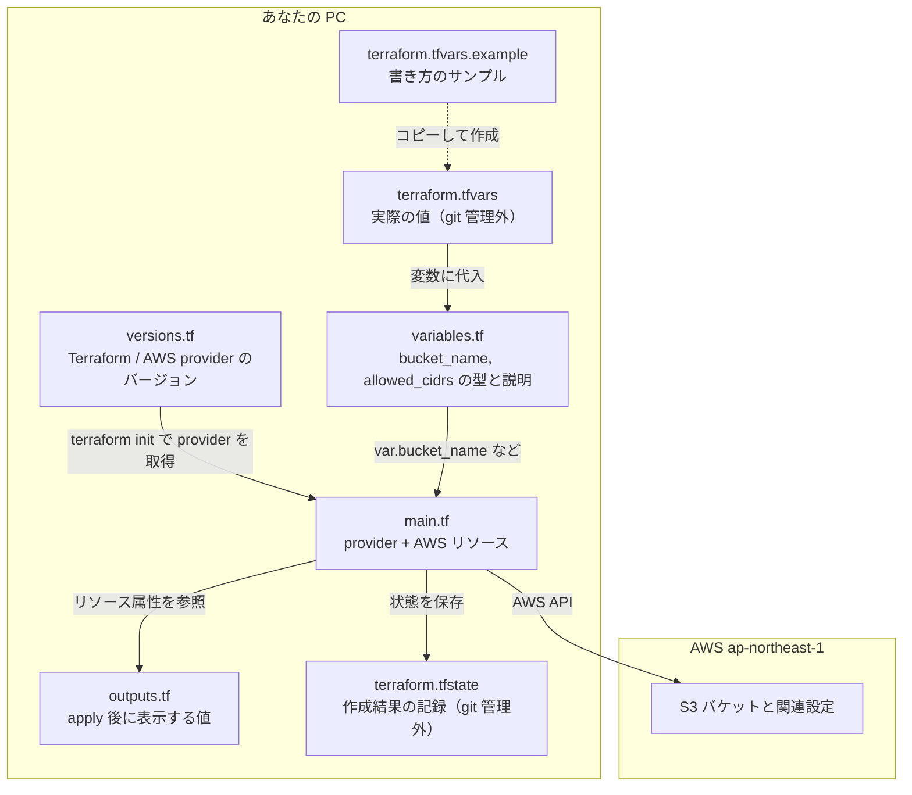
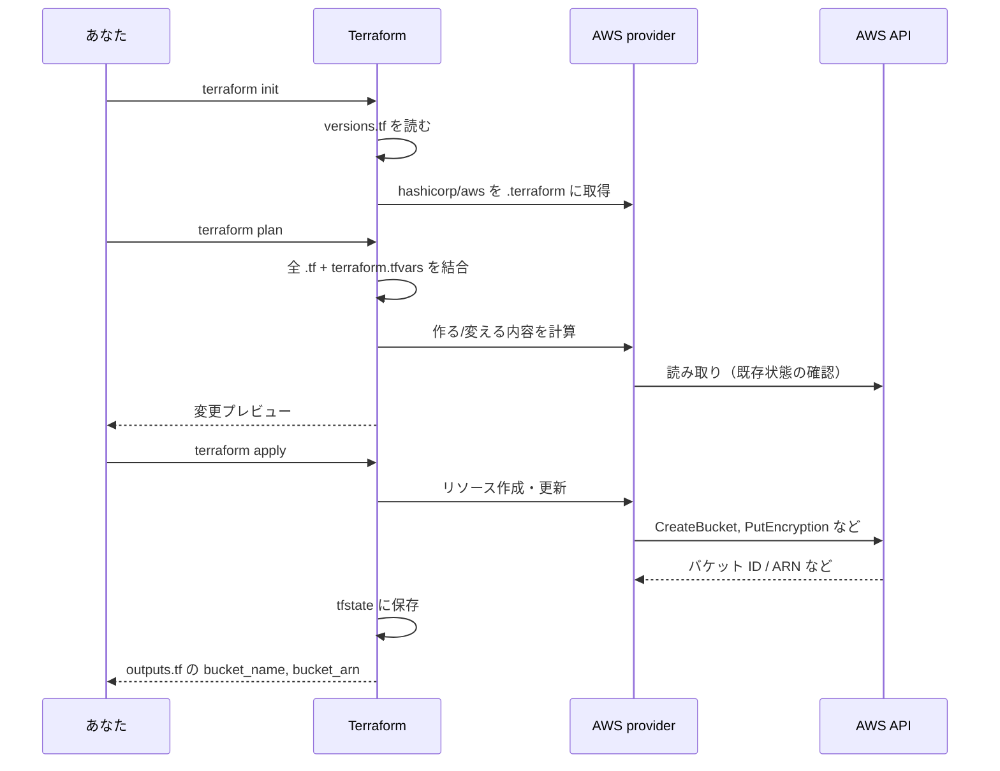
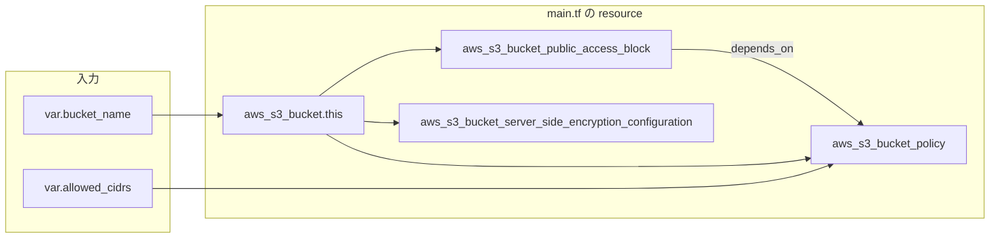
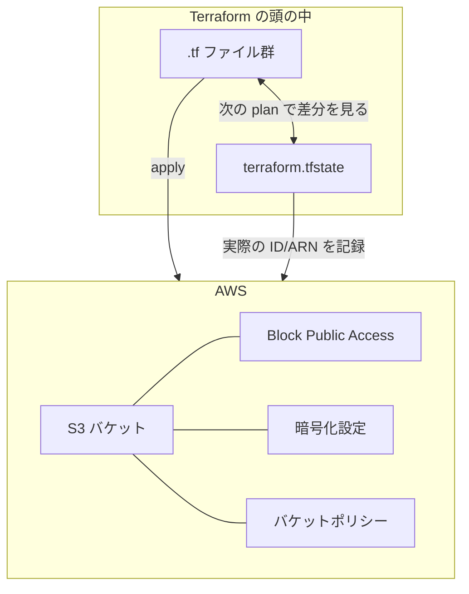

# Terraform ファイルの関係と動き方

このリポジトリでは、**Terraform が `.tf` をまとめて 1 つの構成として読み、変数で値を受け取り、AWS にリソースを作る**流れになっています。ファイル名でモジュールが分かれているわけではなく、同じディレクトリの `.tf` はすべて 1 枚の設計図として結合されます。

## 各ファイルの役割とつながり



| ファイル | 役割 | 誰が読むか |
|---|---|---|
| `versions.tf` | 使う Terraform / provider のバージョンを固定 | `terraform init` |
| `variables.tf` | 入力の「名前・型・説明」だけ定義（値は書かない） | `plan` / `apply` |
| `terraform.tfvars` | 実バケット名・実 CIDR の値 | 自動で変数に渡される |
| `main.tf` | 東京リージョンと S3 まわりのリソース本体 | `plan` / `apply` |
| `outputs.tf` | 作ったあとターミナルに出す情報 | `apply` 完了時 |
| `terraform.tfstate` | AWS に何が作られたかの記録 | Terraform 自身（次回の差分計算用） |

`plan.md` と `README.md` は Terraform の実行には入りません。人向けの説明です。

## コマンドが動くときの流れ



- **init**: プラグインの準備だけ。AWS にはまだ触らない。
- **plan**: 「こう変わる」という差分の見積もり。
- **apply**: 実際に AWS に反映し、結果を state に書き、`outputs` を表示。

認証は Terraform では書いていません。`provider "aws"` が、環境の AWS 認証情報（`~/.aws/credentials` など）を使います。

## main.tf 内のリソースの依存関係

値の流れと、作る順序は次のイメージです。



1. **バケット**を先に作る（名前は `var.bucket_name`）。
2. 同じバケットに **公開ブロック**と**暗号化**を付ける（`aws_s3_bucket.this.id` で紐づけ）。
3. **バケットポリシー**で `var.allowed_cidrs` 以外を Deny。`depends_on` で公開ブロックの後に付ける。

`outputs.tf` は作成済みバケットの `bucket` と `arn` を参照するだけで、AWS には新しいリソースを作りません。

## 1 本の線でたどる例（バケット名）

```
terraform.tfvars の bucket_name
    → variable "bucket_name"（variables.tf）
    → resource "aws_s3_bucket" の bucket = var.bucket_name（main.tf）
    → AWS にバケット作成
    → output "bucket_name" が aws_s3_bucket.this.bucket を表示（outputs.tf）
```

CIDR も同様で、`allowed_cidrs` → `var.allowed_cidrs` → バケットポリシーの `aws:SourceIp` に入ります。

## 実行後の世界



**コード（.tf）** が望む形、**state** が「いま AWS に何があるか」の記録、**AWS** が実物です。次に `plan` するときは、コードと state と実際の AWS を突き合わせて、足りないものを作る・変わったものを直す、という動きになります。

## まとめ

- すべての `.tf` は **1 つの構成**として合体する。
- **値**は `terraform.tfvars` → **variables.tf** → **main.tf** の `var.*` へ流れる。
- **main.tf** が provider 経由で **AWS** に 4 種類の設定を付ける。
- **outputs.tf** は結果を表示するだけ。
- **versions.tf** は init 用の前提、**state** は apply のあと Terraform が差分管理に使う。

関連: [README.md](README.md)（手順）、[plan.md](plan.md)（設計と運用の詳細）。
